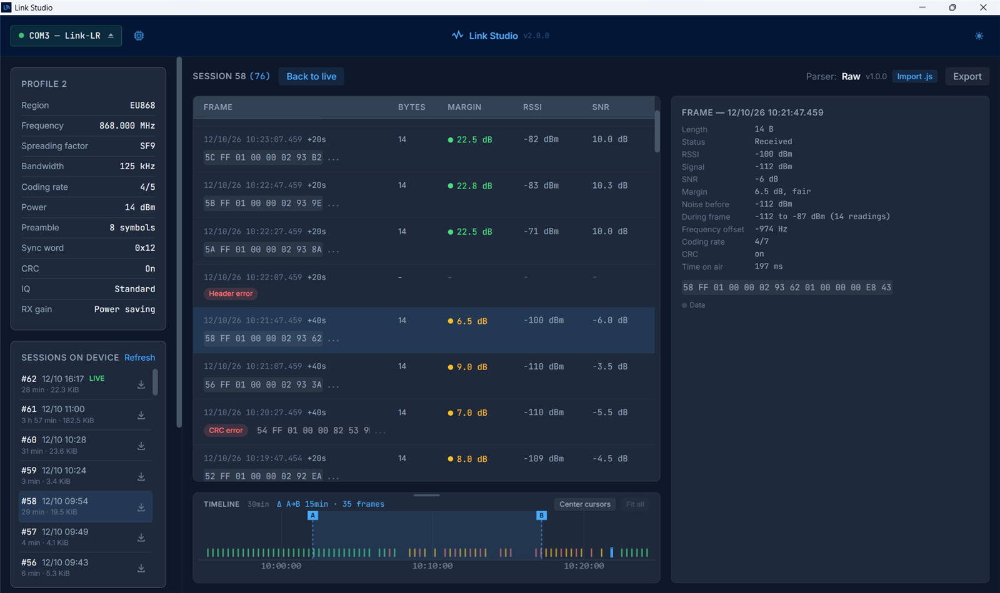

# Link Studio



Desktop app for the **Semtronik Link** devices. Part of the
[Semtronik Link project](https://github.com/semtronik/link).

First supported device: **Link-LR**, a LoRa traffic analyzer and generator
(LoRa P2P, 868/915 MHz). The device works on its own; Link Studio is where
its recordings are read at length, decoded and kept.

> Using the **LFT prototype**? It is not supported by Link Studio. Use
> [lft-app 1.0.0](https://github.com/semtronik/link-studio/releases/tag/v1.0.0),
> its last compatible version.

## What it does

Connected to a Link-LR over USB:

- **Journal** — every reception, live: payload, RSSI, SNR, and the **link
  margin**, colored as on the device. Errors are rows too (CRC error, header
  error, incomplete frame), and so are our own transmissions and any break
  in reception.
- **Timeline** — frames drawn by time on air, with two cursors to measure
  intervals and count frames.
- **Frame detail** — every measurement the device takes: signal and noise,
  RSSI readings during the frame, frequency offset, coding rate, time on
  air. Any payload can be sent again.
- **Transmit** — type a payload in hex, put it on air.
- **Radio profile** — read and set region, frequency, SF, bandwidth, coding
  rate, power, preamble, sync word, CRC, IQ and receiver gain.
- **Sessions** — the device records everything, always. Link Studio lists
  the sessions it holds, opens any of them and saves them as `.jsonl` files,
  which it opens again later without the device.
- **Decoders** — load a JavaScript parser for your own protocol and see its
  fields on every frame. See [docs/protocol-parser-spec.md](docs/protocol-parser-spec.md)
  and [examples/demo-protocol.js](examples/demo-protocol.js).
- **Device** — firmware update over USB, and the device's event log.

The device↔app protocol and the recording format are specified in
[link/protocol](https://github.com/semtronik/link/tree/main/protocol).

## Install

Windows installers are published in
[Releases](https://github.com/semtronik/link-studio/releases). macOS and
Linux: build from source, below.

The Link-LR uses the ESP32-S3's native USB: **no driver to install**. Plug it
in, pick its port in Link Studio; the port list shows it as "Link-LR" once
identified.

On Linux, add yourself to the `dialout` group to open serial ports:
`sudo usermod -aG dialout $USER`, then log out and back in.

## Build from source

Prerequisites:

- **Node.js** ≥ 18
- **Rust** stable, via [rustup.rs](https://rustup.rs/)
- **Tauri 2 system dependencies** for your OS: see the
  [Tauri prerequisites guide](https://v2.tauri.app/start/prerequisites/)

```bash
git clone https://github.com/semtronik/link-studio.git
cd link-studio
npm install
npm run tauri build
```

The installers land in `src-tauri/target/release/bundle/`.

For development, `npm run tauri dev` starts the app with hot reload.

Stack: Tauri 2 (Rust) with React 19, TypeScript and Tailwind CSS.

## Troubleshooting

**The device does not appear, or shows as an unknown port**

- Check that the USB cable carries data, not only charge.
- Another application may hold the port (serial monitor, Arduino IDE…):
  the port list then says so. Close it.
- A device showing as "LFT prototype" runs the prototype's firmware: use
  lft-app 1.0.0.

**Logs**

Link Studio writes `app.log` in its data folder
(`%APPDATA%\com.semtronik.link-studio\logs` on Windows). Set
`LINK_STUDIO_DEBUG=1` before starting it for the detail of every command.

## License

MIT — see [LICENSE](LICENSE).
